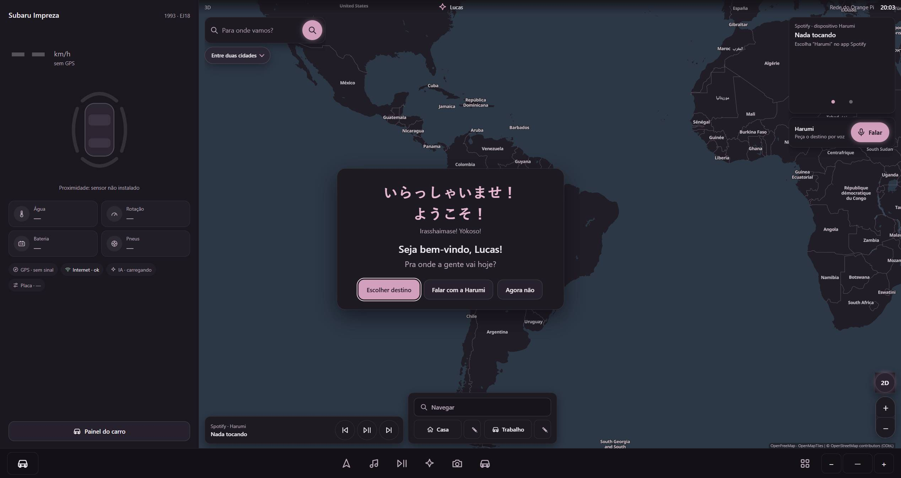
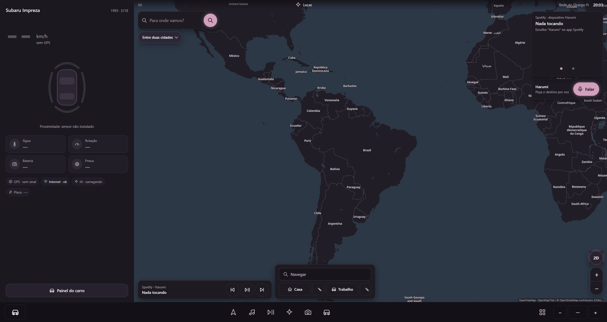
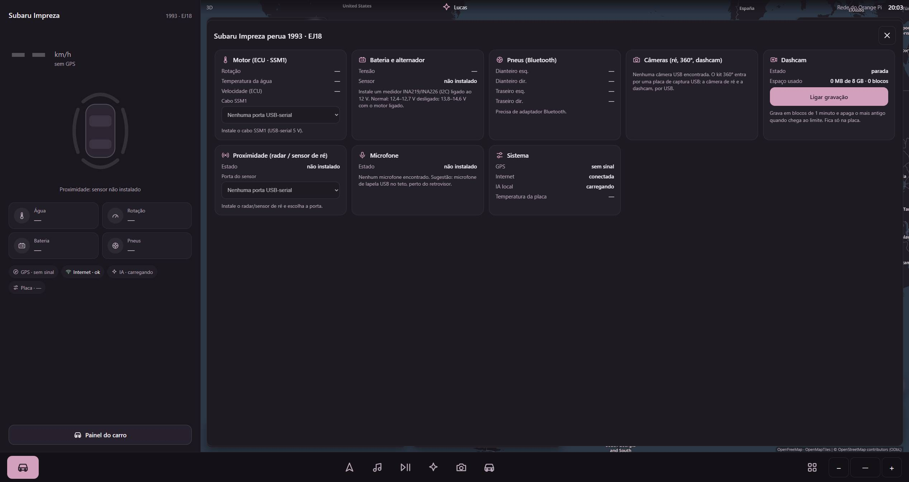
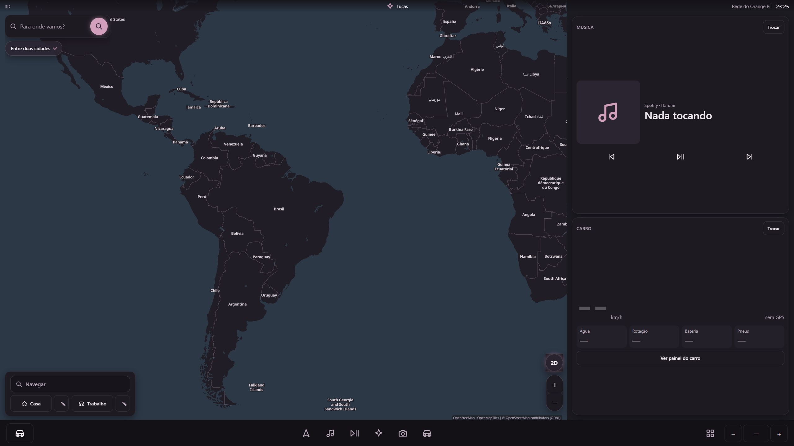
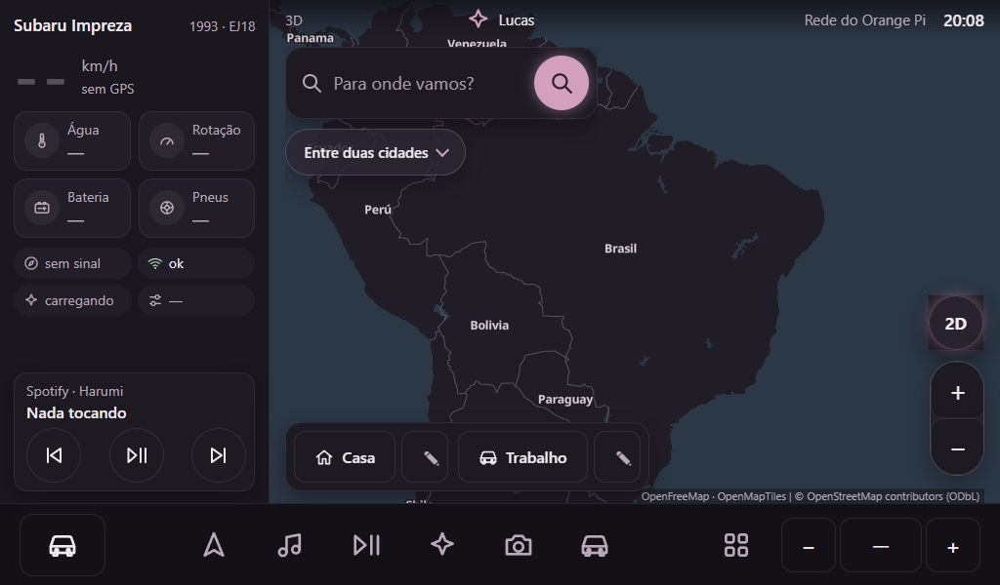

<div align="center">

# Harumi Auto OS

**Central multimídia com assistente de voz local para um Subaru Impreza SW 1993**

Mapas, música, painel do carro e a assistente Harumi — tudo rodando no próprio carro, com IA offline.



`Android` · `Ubuntu no Orange Pi 5` · `Electron` · `Python` · `llama.cpp` · `Vosk` · `OpenStreetMap`

</div>

---

## Sobre o projeto

O Harumi Auto OS substitui a interface da central multimídia de um Subaru Impreza perua 1993 (motor EJ18) por um sistema próprio, com uma assistente de voz chamada **Harumi**. A conversa, o reconhecimento de fala e a voz funcionam **sem internet**: os modelos de IA rodam no próprio aparelho.

O projeto tem duas camadas:

- **App Android** — a primeira versão, feita para a central Android original do carro.
- **Camada Linux** — a versão atual, que roda no **Orange Pi 5** com Ubuntu: interface em Electron, servidor local em Python, IA local, mapas offline, tela dividida e módulos do carro.

## Telas

| Tela inicial | Painel do carro |
|:---:|:---:|
|  |  |
| **Tela dividida (monitor grande)** | **Tela de 7 polegadas** |
|  |  |

## O que ele faz

- **Assistente Harumi** — conversa por texto ou voz com um modelo Qwen local (llama.cpp), reconhecimento de fala em português com Vosk e voz feminina sintetizada no aparelho.
- **Navegação** — mapa OpenStreetMap com zoom e arrasto, busca de destino, rotas entre cidades, atalhos Casa/Trabalho e atlas offline dos estados e capitais.
- **Música** — controles de mídia integrados ao Spotify e aos apps instalados.
- **Painel do carro** — rotação, temperatura da água, bateria, pneus, sensor de ré, câmeras e dashcam, prontos para receber os sensores (cabo SSM1, INA219/INA226, TPMS Bluetooth, câmeras USB).
- **Tela dividida** — mapa, música e carro lado a lado, com painéis trocáveis.
- **Privacidade** — conversas só na memória da sessão, sem gravação de áudio; a IA nunca executa comandos de sistema.

## Estado atual

Protótipo de bancada. A interface, a IA local e os mapas funcionam; a ligação física com o carro ainda não está homologada.

- Sem adaptador conectado ao Subaru: os dados do motor aparecem como "—" até a instalação dos sensores. OBD-II não é presumido em um carro de 1993.
- Sem escuta permanente: a Harumi só ouve depois de tocar em **Falar**.
- Ré, câmera 360°, telefonia e energia/ACC ainda dependem de teste no hardware.

Detalhes em [docs/STATUS.md](docs/STATUS.md).

## Estrutura

```
app/            App Android (assistente, voz, mapas, launcher)
compatibility/  Verificador de compatibilidade da central
linux/          Camada Linux para o Orange Pi 5 (Electron + Python)
docs/           Pesquisa, decisões de arquitetura, testes e capturas
```

## Como rodar

**Orange Pi 5 (Linux):** copie a pasta `linux/` para `~/harumi` e rode `sh ~/harumi/install.sh` com o usuário da sessão gráfica. Os serviços sobem pelo `systemd --user`.

**Android:** Android Studio com JDK 17, SDK 35, NDK 27.2.12479018 e CMake 3.22.1. Depois:

```
gradlew.bat :app:assembleDebug :app:testDebugUnitTest :app:lintDebug
```

Os modelos de IA acompanham o APK (reserve ao menos 3 GB livres). Arquiteturas: ARM64 para a central e x86_64 para emulador; mínimo Android 8 (API 26).

Leituras recomendadas: [ADR-008 — IA local](docs/ADR-008-IA-local.md), [Validação da IA](docs/VALIDACAO-IA.md), [Componentes de terceiros](docs/TERCEIROS.md).

<details>
<summary><b>Histórico de versões do app Android</b></summary>

- **0.3.2** — voz F3 com entusiasmo aprovada por Lucas; perfil 1.25/0.72 e apresentação iguais à amostra. Ver docs/VALIDACAO-032.md.
- **0.3.3** — Falar com Harumi na HOME, painel Conexões, status observado pelo Android e atalhos Wi-Fi/Bluetooth/redes. Bluetooth/USB físicos dependem da central. Ver docs/VALIDACAO-033.md.
- **0.3.4** — opção USB retirada; Wi-Fi/Bluetooth recolhidos como configuração inicial. Status da rede automático. Ativação universal do roteador do telefone não implementada; conferir docs/INTERNET-AUTOMATICA.md. Escopo inclui iPhone e Android de várias marcas.
- **0.3.5** — personagem animada com saudação, espera, escuta, processamento e fala; visível na conversa. Ver docs/HARUMI-CONSOLE.md.
- **0.3.6** — interface escura e rosa inspirada na Harumi IA, com elementos de OS dos anos 1990; personagem sem quadriculado, composta sobre o painel. Ver docs/INTERFACE-RETRO-036.md.
- **0.3.7** — visual retrô substituído pelo estilo original da Harumi IA, adaptado à multimídia. Ver docs/INTERFACE-ORIGINAL-037.md.
- **0.3.8** — estrutura da primeira interface com botões grandes, identidade preta/rosa da Harumi e efeitos; seletor de múltiplos apps instalados para navegação/música. Ver docs/INTERFACE-E-APPS-038.md.
- **0.3.9** — referência comercial identificada como Aikon Fóton F09-88256/360/G3 conforme código fornecido e catálogo oficial. Política ABI/API, inventário e exportação local no app e em verificador leve independente. Hardware de Lucas ainda não homologado. Ver docs/COMPATIBILIDADE-FOTON-G3.md.
- **0.3.10** — personagem parada fora da resposta falada, correção do ciclo da autorização inicial de microfone, falhas/interrupções visíveis e tempo transcorrido. LLM real testado na bancada; entrada de áudio do LDPlayer ainda pendente. Ver docs/RESPOSTA-E-ANIMACAO-0310.md.
- **0.3.11** — respostas sociais por regras, prompt/contexto menores, runtime reutilizado, até quatro threads e orçamento de inferência; ações aparecem antes da síntese terminar. Medidas e limites em docs/OTIMIZACAO-0311.md; mapas e pesquisa próprios ainda planejados em docs/MAPAS-E-IA-LOCAL.md.
- **0.3.12** — atlas dos estados e fotos das capitais offline; cache PCM da voz aprovada para respostas fixas.
- **0.3.13** — planejamento gráfico entre cidades, rota viária real OSRM, mapa OpenStreetMap com zoom/arrasto, comandos locais entre duas cidades e estimativas sem trânsito. Não inclui acompanhamento GPS nem recálculo automático. Ver docs/MAPA-ROTAS-0313.md.
- **0.3.14** — painel Aplicativos, catálogo de referência Fóton, inventário do Android, abertura e acesso à loja oficial; funções OEM associáveis aos apps da própria central. Nenhum app de terceiros incorporado ou instalado automaticamente. Pesquisa, fontes e limites em docs/APPS-FOTON-0314.md.
- **0.3.15** — launcher inspirado na referência enviada, com dock, grade de ícones, apps instalados com ícones nativos e controles de mídia do Android. Contexto de 4096 tokens, até quatro trocas completas, geração parcial visível e Continuação explícita. Captura não para no primeiro segmento Vosk; janela de 45 s, pausa de 1,8 s após endpoint e conclusão manual. Mensagens até 1600 caracteres. Ver docs/ENTREGA-0315.md.

</details>

## Autor

Criado por **Lucas Barkoski**.
