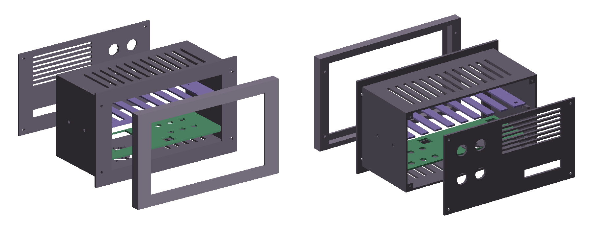

# Caixa da Harumi: moldura da tela + caixa 2-DIN (versão 0, medidas estimadas)

> **Não imprima a versão final antes de medir.** As medidas da tela e do vão do rádio do Impreza 1993 são estimativas.
> Imprima primeiro só a moldura (`1_moldura_tela.stl`, uns 60 g) como teste de encaixe com a tela em mãos.

## Peças

| Arquivo | O que é | Tamanho (mm) | Imprimir |
|---|---|---|---|
| `1_moldura_tela.stl` | Moldura da frente; a tela encaixa por trás | 192 × 114 × 11 | Face da frente na mesa |
| `2_caixa_2din.stl` | Corpo que entra no vão do rádio, com flange, trilhos, grade da fan e furos | 192 × 114 × 88 | Flange na mesa (abertura para cima) |
| `3_bandeja_pi.stl` | Bandeja de baixo: Orange Pi 5 + conversor | 172 × 2 × 62 | Deitada |
| `4_bandeja_hub_4g.stl` | Bandeja de cima: hub USB + modem 4G (abraçadeiras) | 172 × 2 × 62 | Deitada |
| `5_tampa_traseira.stl` | Tampa de trás com grade e passa-fios de 14 mm | 178 × 98 × 2,5 | Deitada |

## Material e configuração

- **ASA** (melhor: aguenta calor e sol) ou **PETG** (mínimo). **Não use PLA**: amolece no carro quente.
  Temperaturas de amolecimento (de memória): PLA ~60 °C, PETG ~80 °C, ASA ~100 °C. Confira na ficha do filamento.
- Camada 0,2 mm, 4 perímetros, 25 % de preenchimento. A caixa precisa de suporte só nos furos laterais (ou dispense).
- Os STLs foram gerados por voxels de 0,4 mm: os círculos saem levemente "em degraus", sem efeito na montagem.
  Se o fatiador oferecer "reparar malha", pode aceitar.

## Ferragens

- 4 parafusos **M3 × 10 auto-atarraxantes**: moldura ↔ flange.
- 4 parafusos **M3 × 10 auto-atarraxantes**: tampa traseira.
- 4 parafusos **M3 × 16 + porcas**: ventoinha 40 × 40 × 10 mm (5 V) no fundo.
- Kit de **espaçadores de nylon M2.5** (10 mm) para o Orange Pi. A bandeja tem janelas grandes: os furos do Pi caem
  em qualquer ponto delas.
- Abraçadeiras de nylon de 3 mm: hub e 4G na bandeja de cima.
- Passa-fios de borracha de 14 mm (opcional) nos furos da tampa.

## Montagem

1. Encaixe a tela por trás da moldura e prenda a moldura na flange da caixa (4 × M3).
2. Parafuse a ventoinha no fundo, soprando **para dentro** (seta do fabricante voltada para o Pi).
3. Monte o Pi e o conversor na bandeja de baixo; o hub e o 4G na de cima. Deslize as bandejas nos trilhos.
4. Passe os cabos pelos passa-fios e pelo rasgo do 12 V/ACC; feche a tampa (4 × M3).

## O que medir antes da versão final

1. Tela: largura, altura e espessura da placa; posição da área visível (se não for centralizada); onde saem
   os conectores HDMI e USB.
2. Vão do rádio do Impreza: largura × altura × profundidade, e se há gaiola com abas laterais.
3. Orange Pi 5 com o dissipador escolhido: altura total.

Para ajustar, mude as medidas no topo de `gerar_caixa.py` e rode `python gerar_caixa.py` (precisa só de Python e numpy).
`python previa.py` refaz a imagem de prévia.

## Caixinha de serviço (20/11/2026)

O modelo em tamanho real (`montagem-3d.html`) mostrou que o hub ORICO (145×58×26) e o modem não cabem com folga na
2-DIN. Eles saíram dela e vão para uma caixinha de serviço (porta-luvas ou atrás do painel), ligada ao Orange Pi por
um cabo USB 3.0 curto. A 2-DIN fica só com a tela, o Orange Pi, o conversor e a ventoinha.

| Arquivo | O que é | Tamanho (mm) |
|---|---|---|
| `6_caixa_servico.stl` | Caixinha: hub, modem (deitado, extensor USB curto), PC817 e relé lado a lado; fendas de abraçadeira, 4 passa-fios de 14 mm atrás, furo do cabo USB na frente, orelhas M4 | 180 × 133 × 73 (208 com as orelhas) |
| `7_tampa_servico.stl` | Tampa com grade de ar sobre o hub, 4 × M3 nas colunas | 180 × 133 × 2,5 |

Gerar de novo: `python gerar_caixa_servico.py`. A `4_bandeja_hub_4g.stl` deixou de ser usada.
Antes de imprimir: medir o hub e os módulos que chegarem e o espaço do porta-luvas [VERIFICAR].
Na 2-DIN continua pendente o espaço dos plugues atrás do Orange Pi: use cabos com plugue em 90° ou aumente `CORPO_P`.

## Plugues do Orange Pi resolvidos (20/11/2026)

- `CORPO_P` passou de 85 para **100 mm**: com cabos de **plugue em 90°** sobram ~19 mm atrás do Orange Pi (pedem ~16).
  Confirme que o vão do rádio tem pelo menos ~115 mm de profundidade (100 + flange + folga) [VERIFICAR].
- O **conversor 12→5 V saiu de dentro da caixa**: vai preso por fora da tampa traseira (4 fendas de abraçadeira na
  `5_tampa_traseira.stl`), ligado ao Orange Pi por um cabo USB-C em 90° curto. O Orange Pi fica mais para o centro,
  com espaço para plugues em 90° na lateral esquerda; a ventoinha acompanhou (`FAN_X = -20`).
- A caixa não tem mais o trilho da bandeja de cima. STLs regenerados: 1, 2, 3 e 5.

## Tela de 10,1" (Hosyond 1280×800, escolhida em 20/11/2026)

| Arquivo | O que é | Tamanho (mm) |
|---|---|---|
| `1b_moldura_tela_10pol.stl` | Frente da moldura flutuante: aba com a janela e bolso aberto atrás; 4 furos cegos M3 nos cantos | 252 × 166 × 9 |
| `1c_traseira_tela_10pol.stl` | Traseira: segura a tela (4 × M3 nos cantos), parafusa na flange 2-DIN nos mesmos 4 furos da moldura de 7" (M3 × 16 com porca); abertura de 120 × 80 para a placa e os cabos; grade de ar | 252 × 166 × 3 |

- A moldura fica **na frente do vão**, mais larga (252 contra 192) e mais alta (166 contra 114). `M10_DY` sobe ou desce a tela.
- **Medidas da tela estimadas** pelo padrão 16:10 de 10,1" (o anúncio não informa): meça a tela que chegar e ajuste
  `T10_L`, `T10_A`, `T10_E`, `J10_*` e `P10_*` no `gerar_caixa.py`. Se ela vier numa capa própria, meça a capa.
- **Mesa da impressora:** a moldura tem 252 × 166 mm. Mesa de 220 × 220 (Ender 3 e parecidas) não cabe: use uma
  impressora com mesa de 256 mm ou mais (serviço de impressão), ou peça para dividir a moldura em duas metades.
- A tela de 10" pesa mais e balança no carro: imprima em ASA com 5 perímetros e 30 % de preenchimento.
- A `1_moldura_tela.stl` (7") continua valendo para a bancada.

## Plano novo: tela em cima do painel, central embaixo do painel (20/11/2026)

As fotos do carro mostraram que o vão do rádio é **1-DIN** e que o rádio é um **Pioneer** (não o original). A caixa
2-DIN saiu; as peças dela estão em `antigo-2din/` (o gerador ainda as faz com `PECAS = PECAS_2DIN`).

| Arquivo | O que é | Tamanho (mm) |
|---|---|---|
| `1b_moldura_tela_10pol.stl` | Frente da moldura da tela de 10,1" | 252 × 166 × 9 |
| `1c_traseira_tela_10pol.stl` | Traseira: segura a tela, grade de ar, **lingueta da articulação** (furo M6) | 252 × 166 × 23 |
| `1d_suporte_tela_painel.stl` | Suporte no tampo do painel: base 150 × 90 com 4 furos de 4,5 mm, orelhas do eixo M6 a 40 mm do tampo, reforços, rasgo dos cabos | 150 × 90 × 50 |
| `6_caixa_central.stl` | Caixa única da central: Orange Pi (20 mm de folga na frente e à esquerda para plugues em 90°), conversor, hub, modem, PC817, relé; 2 furos de 25 mm na frente (HDMI e touch), 6 de 22 mm atrás, saída de ar à direita | 205 × 195 × 73 (233 com orelhas) |
| `7_tampa_central.stl` | Tampa com a **ventoinha de 40 mm sobre o Orange Pi** e grade sobre o hub | 205 × 195 × 2,5 |

Geradores: `python gerar_caixa.py` (moldura e suporte) e `python gerar_caixa_central.py` (caixa da central).

- **Articulação:** parafuso M6 × 60 com porca autotravante e 2 arruelas; aperte até a tela ficar firme na inclinação
  escolhida (o modelo 3D usa 20°). `SUP_ALT` muda a altura do eixo.
- **Antes de imprimir:** faça um gabarito de papelão de 252 × 166 mm e prenda no tampo na altura do modelo (borda de
  cima a ~17 cm do tampo). Sente no banco e veja se ele não entra na linha de visão pelo para-brisa nem cobre o
  desembaçador. Meça também o tampo (largura plana disponível e curvatura) para ajustar a base.
- **Calor:** a central fica embaixo do painel do passageiro, onde pega ar da cabine; dentro do porta-luvas fechado o
  Orange Pi passa de 80 °C. Use quebra-sol: o tampo do painel esquenta muito parado ao sol.
- **Mesa da impressora:** a moldura e a caixa da central passam de 220 mm; precisa de mesa de 256 mm ou mais.

## Tela de 13,3" Full HD (troca da Hosyond 10,1", 20/11/2026)

Para assistir filme com o carro parado, a tela passou a ser uma **13,3" 1920×1080 touch** (medidas estimadas:
módulo ~306 × 184 × 8, janela 294 × 166). A moldura ficou com **323 × 201 mm** e sai **em 2 partes por peça**, com
cortes desencontrados (frente em x = −50, traseira em x = +50) e 2 parafusos M3 extras de cada lado de cada corte:

| Arquivo | Tamanho (mm) |
|---|---|
| `1b_moldura_tela_13pol_esq.stl` / `_dir.stl` | 111 × 201 × 11 / 212 × 201 × 11 |
| `1c_traseira_tela_13pol_esq.stl` / `_dir.stl` (a lingueta fica na esquerda) | 211 × 201 × 23 / 112 × 201 × 3 |
| `1d_suporte_tela_painel.stl` (base 180 × 100, lingueta de 40 mm) | 180 × 100 × 50 |

Todas cabem numa mesa de 220 × 220. A traseira cobre o corte da frente e vice-versa: cole as metades com cola para ASA
e aperte todos os parafusos M3. Gabarito: `GABARITOS-1x1.pdf`, páginas 1 e 2 (as duas metades da tela).

## Ventilação empurra e puxa + ar-condicionado (ideia do Lucas, 20/11/2026)

- `7_tampa_central.stl` agora tem **2 aberturas de 80 mm** com grade: **entrada** sobre o Orange Pi e **saída** no canto
  oposto, para o ar atravessar a caixa inteira. As ventoinhas (Noctua NF-A8 5V PWM ou equivalente) vão **por fora** da
  tampa, com 4 parafusos M4 auto-atarraxantes (furos a 71,5 mm). Confira a seta de fluxo de cada ventoinha na montagem.
- `8_bocal_ar_condicionado.stl` (opcional) encaixa sobre a ventoinha de entrada e recebe uma **mangueira de 50 mm**
  vinda da saída de ar do passageiro: com o ar-condicionado ligado, a central respira ar frio.
- **Cuidados:** com o ar no **quente** (inverno), tire a mangueira ou feche aquela saída, senão a caixa recebe ar quente.
  Vede os passa-fios com borracha para o ar sair pela ventoinha de saída, não pelos furos. As ventoinhas da caixa
  resfriam o ar em volta do Orange Pi; o teto de 1,8 GHz e o case com fan continuam valendo.
- A saída de ar do passageiro do Impreza ainda não foi medida: o encaixe da mangueira lá é [VERIFICAR].

## Por onde sai o ar quente (20/11/2026)

A tampa fica virada para cima, embaixo do porta-luvas: se a ventoinha de saída soprasse para cima, o ar quente ficaria
preso no vão atrás do porta-luvas e voltaria para a entrada. Por isso:

- `9_capuz_saida_ar.stl` (80 × 92 × 43 mm) encaixa sobre a ventoinha de **saída** (mesmos 4 furos) e vira o ar 90°
  para a **cabine**, com uma aba que aponta para o **assoalho do passageiro**. O calor (uns 15 a 20 W da central
  inteira, estimativa) se mistura ao ar da cabine e o ar-condicionado dá conta.
- A **entrada** precisa pegar ar de fora desse vão: com o bocal e a mangueira ligados à saída de ar do passageiro
  (ar-condicionado) ou, sem ar-condicionado, com a mangueira descendo até perto do assoalho, onde o ar é mais fresco.
- Altura total sobre a tampa: ventoinha 25 + capuz 43 = 68 mm. Somando a caixa (73), a central pede **~141 mm de
  altura livre** embaixo do porta-luvas [VERIFICAR com a medida].
- Parado ao sol com o carro fechado, nenhuma ventoinha esfria abaixo da temperatura da cabine: o governador térmico
  continua sendo a proteção.
