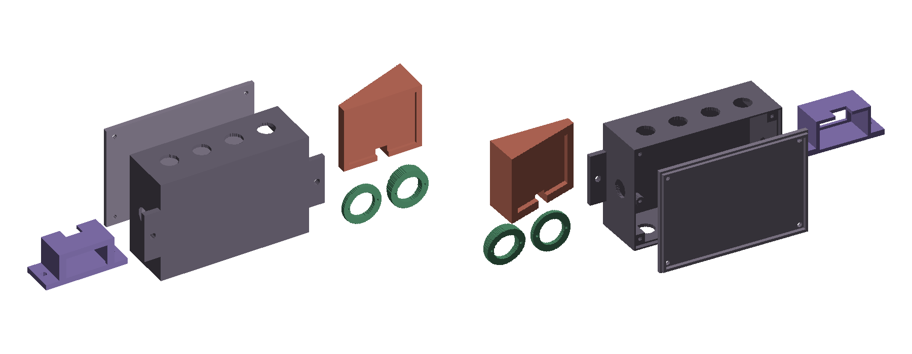

# Sensores 360 da Harumi: visão de cima + distâncias reais (versão 0)

> Projeto de **auxílio** ao motorista, não sistema de segurança. Medidas e pinos marcados **[VERIFICAR]** são de memória
> ou estimativa: confira com as peças em mãos antes de furar, soldar ou imprimir.



## 1. Como funciona

```
                 ┌────────────── NÓ DIANTEIRO (atrás da grade) ──────────────┐
 6 ultrassons ──►│ ESP32-S3 + divisores de tensão + conversor 12→5 V         │──USB──► hub ──► Orange Pi (Harumi)
 2 radares    ──►│ junta tudo e manda 10 vezes por segundo                   │
 1 lidar      ──►│                                                            │◄── sem fio (ESP-NOW)
                 └────────────────────────────────────────────────────────────┘          ▲
                 ┌────────────── NÓ TRASEIRO (atrás do para-choque) ──────────┐          │
 6 ultrassons ──►│ ESP32-S3 + divisores de tensão + conversor 12→5 V         │──────────┘
 2 radares    ──►│                                                            │
                 └────────────────────────────────────────────────────────────┘
 Kit 360 (4 câmeras + caixa própria) ──saída de vídeo──► placa de captura USB ──► hub ──► Orange Pi
```

- **Ultrassom (12):** 4 no para-choque dianteiro, 4 no traseiro, 2 em cada lateral. Manobra, de 0,25 a ~4 m.
- **Radar 24 GHz (4):** um em cada canto, por dentro do para-choque. Carro chegando, ponto cego e ré saindo da vaga.
- **Lidar (1):** na frente, distância exata do carro da frente (até ~12 m).
- **Kit 360:** monta sozinho a imagem "de cima"; a Harumi desenha por cima os anéis verde/amarelo/vermelho e os centímetros.
- O nó traseiro conversa **sem fio** com o dianteiro (ESP-NOW): não precisa passar cabo de dados pelo carro, só a alimentação.

## 2. Compras (Amazon Brasil, preços de 20/11/2026)

| Item | Qtd | Preço | Link |
|---|---|---|---|
| Kit 360 **com caixa própria (DVR) e saída de vídeo** | 1 | R$ 1.314,70 | amazon.com.br/dp/B0HL2YM7TC — confirme no anúncio que tem saída AV/CVBS |
| Sensor ultrassônico JSN-SR04T (kit com 3) | 4 kits | 4 × R$ 191,63 | amazon.com.br/dp/B0D1MDY13Y (avulso, nota 5,0: R$ 66,49 — amazon.com.br/dp/B0CDJ4LJCT) |
| Radar 24 GHz HLK-LD2451 (feito para veículos) | 4 | 4 × R$ 172,87 | amazon.com.br/dp/B0GCDL6T5W |
| Lidar TFmini Plus (IP65, 0,1–12 m) | 1 | R$ 425,01 | amazon.com.br/dp/B0BBLRPVDH |
| ESP32-S3 N16R8 (kit com 3; 1 sobra) | 1 kit | R$ 164,25 | amazon.com.br/dp/B0F5QCK6X5 |
| Conversor 12→5 V pequeno (par) | 1 | R$ 24,99 | amazon.com.br/dp/B0CZVLYFZK |
| Kit de resistores (1 kΩ e 2 kΩ para os divisores) | 1 | R$ 26,73 | amazon.com.br/dp/B0GWQJPM3Q |
| Cabo manga 4 vias 22 AWG (30 m) | 1 | R$ 147,43 | amazon.com.br/dp/B09Q3M2ZLY |
| Placa de captura USB (RCA → USB, UVC) | 1 | R$ 114,30 | amazon.com.br/dp/B0CB6BW6X4 (já na lista da central) |
| Loja de elétrica/eletrônica: 2 placas perfuradas 5×7 cm, 12 prensa-cabos PG7, conectores à prova d'água de 4 vias, fusível 2 A em linha (2), termorretrátil | — | — | — |

**Total aproximado: R$ 3.560** (sem a placa de captura, que já está na lista da central, e sem os itens de loja).

**Kit 360 mais barato:** os kits de R$ 160–230 do AliExpress (ex.: pt.aliexpress.com/item/1005008643996836.html,
nota 4,8) são **só as câmeras**: quem junta as imagens é a central Android. Para usar esses, a Harumi teria de juntar
as 4 imagens no Orange Pi (calibração + processamento pesado). Fica como projeto futuro.

## 3. Pinos de cada nó (ESP32-S3 DevKitC-1)  [VERIFICAR com a placa comprada]

Evitados: GPIO 0, 3, 45, 46 (inicialização), 19/20 (USB), 26–37 (memória da N16R8).

| Função | Nó dianteiro | Nó traseiro |
|---|---|---|
| Ultrassom 1–6: TRIG | 4, 5, 6, 7, 15, 16 | 4, 5, 6, 7, 15, 16 |
| Ultrassom 1–6: ECHO (via divisor 1 kΩ/2 kΩ) | 8, 9, 10, 11, 12, 13 | 8, 9, 10, 11, 12, 13 |
| Radar esquerdo (UART1): RX/TX | 17 / 18 | 17 / 18 |
| Radar direito (UART2): RX/TX | 38 / 39 | 38 / 39 |
| Lidar (UART0 remapeada): RX/TX | 40 / 41 | — |
| Livres | 14, 21, 42, 47 | 14, 21, 40, 41, 42, 47 |

- **Divisor do ECHO:** o JSN-SR04T responde em 5 V e o ESP32 aceita 3,3 V. ECHO → 1 kΩ → pino do ESP32 → 2 kΩ → GND
  (5 V × 2/3 ≈ 3,3 V). Um par de resistores por sensor.
- **Radares e lidar:** sinais de 3,3 V, ligam direto. Alimentação de 5 V. [VERIFICAR na ficha de cada módulo]
- **Energia de cada nó:** 12 V do carro → fusível 2 A → conversor 12→5 V → 5 V do ESP32 e dos sensores. Nó traseiro:
  12 V permanente do porta-malas (para funcionar no modo vigia). Nó dianteiro: alimentado pelo USB do hub mais o 5 V
  do conversor para os sensores (GND comum).

## 4. Peças impressas (ASA)

| Arquivo | Qtd | Para quê |
|---|---|---|
| `1_caixa_no_sensores.stl` | 2 | Caixa de cada nó: 110 × 75 × 40 mm, 10 prensa-cabos, colunas para a placa perfurada 5×7 cm, orelhas M4 |
| `2_tampa_no_sensores.stl` | 2 | Tampa com aba e canal para cordão de vedação de 2 mm (4 × M3) |
| `3_anel_ultrassom_reto.stl` | 8 | Arremate da sonda nos para-choques (furo de 18,5 mm [VERIFICAR com a sonda]) |
| `4_anel_ultrassom_10graus.stl` | 4 | Arremate inclinado para as laterais (aponta 10° para baixo/fora) |
| `5_suporte_radar_canto_20.stl` | 4 | Berço do radar colado por dentro do canto do para-choque (20°; o canto já é curvo) |
| `6_suporte_lidar_frente.stl` | 1 | Berço do lidar atrás da grade, com janela para as lentes |

Ajuste as medidas no topo de `gerar_pecas.py` e rode `python gerar_pecas.py`; `python previa.py` refaz a imagem.

## 5. Passo a passo

1. **Bancada primeiro (sem furar nada):** monte um nó na mesa com 2 ultrassons, 1 radar e o lidar. Grave o programa
   do ESP32 e veja as distâncias chegando na Harumi. Só siga quando isso funcionar.
2. **Planejar os furos:** marque com fita crepe os 12 pontos (altura de 45–60 cm do chão, longe de cantos metálicos
   e da placa). Confira por dentro se não há reforço de metal atrás.
3. **Furar e instalar os ultrassons:** broca escalonada no diâmetro da sonda; sonda + anel impresso; teste cada um.
4. **Radares:** cole o berço por dentro de cada canto do para-choque (plástico, sem metal na frente). Pintura metálica
   na frente do radar atrapalha: teste antes de colar.
5. **Lidar:** atrás da grade, com a janela livre; lente limpa e protegida.
6. **Nós:** caixa impressa perto de cada para-choque (dianteiro no cofre longe do calor do motor; traseiro dentro da
   tampa traseira). Cabos com prensa-cabo e conector à prova d'água.
7. **Kit 360:** câmeras na grade, nos retrovisores e na tampa; caixa do kit embaixo do banco; saída de vídeo → placa de
   captura → hub. Faça a calibração do kit com os tapetes/padrões que vêm nele.
8. **Software (sessão principal da Harumi):** programa dos ESP32 (leitura alternada dos ultrassons para um não ouvir o
   outro, radares e lidar), plugin `vehicle.py` lendo o USB, e a tela 360 com os anéis de distância; ao engatar a ré,
   abre sozinha.
9. **Teste de verdade:** num estacionamento vazio, com cones/caixas e uma trena, compare as distâncias da tela com as
   reais em cada lado. Só confie depois disso.

## 6. Proteção elétrica (12 V do carro)

A rede do carro varia de ~11 a ~14,8 V e tem picos e ruído do alternador. Em cada nó, antes do conversor 12→5 V:
fusível de 2 A, diodo TVS de 12 V para os picos e um filtro LC simples (indutor + capacitor eletrolítico) na entrada.
Um conversor isolado é ainda melhor, se couber no orçamento. [VERIFICAR valores do TVS e do filtro antes de comprar]

## 7. Opção B do 360: câmeras soltas + junção no Orange Pi

Em vez do kit com caixa própria (R$ 1.314,70), dá para usar 4 câmeras baratas (ex.: R$ 161,17 no AliExpress) e
juntar as imagens no próprio Orange Pi com o projeto aberto **neozhaoliang/surround-view-system-introduction**
(Python/OpenCV, licença MIT; conferido em 20/11/2026). Exige:
- receber 4 câmeras ao mesmo tempo no Orange Pi (câmeras USB ou captura AHD de 4 canais);
- calibração de cada câmera com tabuleiro xadrez e marcação no chão;
- processamento pesado: mais calor e consumo (testar com a política térmica da Harumi).
Economiza ~R$ 1.100, mas é um projeto inteiro. Fica para depois do sistema principal funcionando.

## 8. Limites

- Ultrassom: bom até ~10 km/h (manobra). Chuva forte, lama e neve atrapalham.
- Radar: não atravessa metal nem pintura metálica; pode dar alarme falso com guard-rail e muro.
- Lidar: sol direto na lente e sujeira reduzem o alcance.
- Furar para-choque é permanente: planeje e teste antes.
